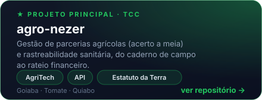
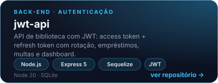
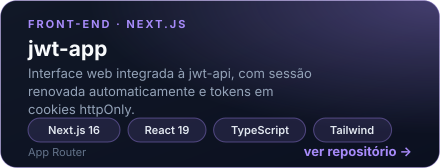
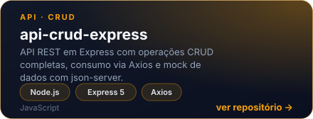
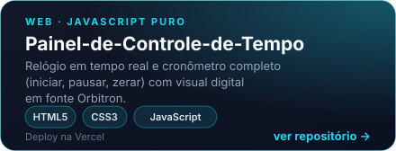
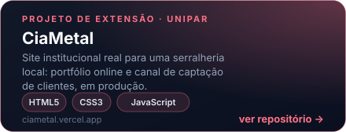



  

---

## 👨‍💻 Sobre mim

Sou **desenvolvedor full-stack** e estudante de **Análise e Desenvolvimento de Sistemas (UNIPAR)**. Construo **APIs REST seguras** com Node.js e **interfaces modernas** com React e Next.js, cuidando do banco de dados ao deploy.

- 💼 **Buscando minha primeira vaga** como desenvolvedor (estágio ou júnior), front, back ou full-stack
- 🔐 Pratico **autenticação de verdade**: JWT com refresh token e rotação, cookies `httpOnly`, análise de riscos de armazenamento de token
- 🧩 **Projetos completos e documentados**: API + front-end integrados, com instruções para rodar e decisões de segurança explicadas
- 🚢 Já entreguei **software em produção para um cliente real** (projeto de extensão da UNIPAR)
- 🌱 Meu TCC, o **Agro Nezer**, é um sistema com regras de negócio e financeiras reais: um bom exemplo de como transformo um problema complexo em software
- 📫 Vamos conversar? Meus contatos estão logo acima
---

## ⭐ Projetos em destaque

<table>
<tr><td></td><td></td></tr>
<tr><td></td><td></td></tr>
<tr><td></td><td></td></tr>
</table>

> 💬 `jwt-api` + `jwt-app` formam um sistema completo. Foi onde mais aprendi sobre segurança de sessão e por que guardar token em cookie `httpOnly` e não em `localStorage`.

---

## 🧰 Tecnologias

**Front-end** 

**Back-end** 

**Linguagens de base e dados** 

**Bancos de dados** 

**Ferramentas e deploy** 

Também no dia a dia: JWT · Sequelize · Axios · json-server · Programação Orientada a Objetos · Análise de dados com Pandas

---

## 📊 GitHub em números

 

